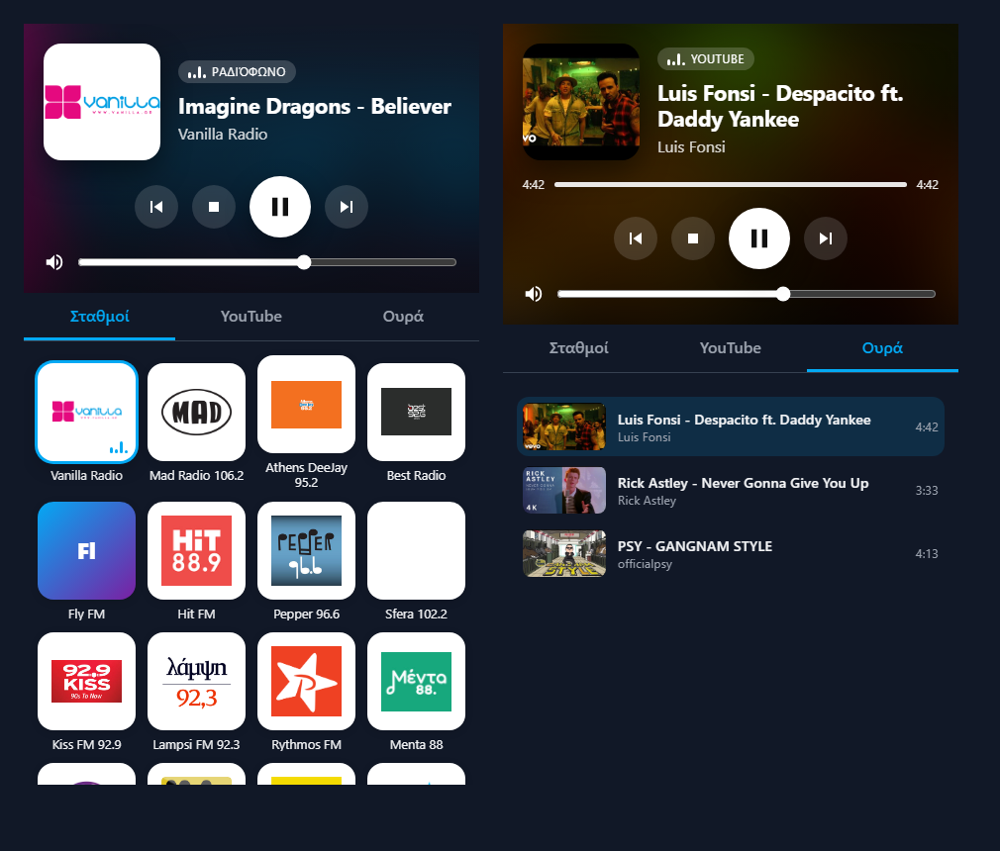

# Home Radio 📻

**Ραδιόφωνο και YouTube που παίζουν από το ίδιο το Home Assistant**, από τα ηχεία του μηχανήματος όπου τρέχει. Έχει τους ίδιους σταθμούς με την εφαρμογή ραδιοφώνου της TV και το ίδιο κόλπο με το YouTube: ψάχνεις τραγούδι, παίζει μόνο ο ήχος, και όταν τελειώσει συνεχίζει μόνο του στο επόμενο.

*Radio stations and YouTube music played by Home Assistant itself through the host's speakers (via the VLC add-on), as a full `media_player` with its own dashboard card.*



## Τι κάνει
- **`media_player.home_radio`**: κανονικός media player με όλους τους σταθμούς ως **sources**, Play/Pause/Stop, επόμενο/προηγούμενο, ένταση, εξώφυλλα και **Media Browser** (σταθμοί, πρόσφατες αναζητήσεις, ουρά).
- **Ραδιόφωνο:** δείχνει το τραγούδι που παίζει τώρα (ICY «Artist - Track») όταν ο σταθμός το στέλνει.
- **YouTube:** αναζήτηση → παίζει το πρώτο και βάζει τα υπόλοιπα στην **ουρά**. Στο τέλος κάθε τραγουδιού πάει στο επόμενο, παραλείποντας ό,τι δεν μοιάζει με τραγούδι (κάτω από 30″ ή πάνω από 12′), και ψάχνει μόνο του για περισσότερα όταν τελειώσει η ουρά.
- **Λίστες YouTube / YouTube Music:** ένα link λίστας, άλμπουμ ή mix (οτιδήποτε έχει `list=`) στην αναζήτηση ή από την Κοινοποίηση της εφαρμογής κινητού: παίζει όλη και κρατιέται στις Λίστες, όπως οι λίστες Spotify.
- **Λίστες Spotify, χωρίς Spotify:** επικολλάς link λίστας, άλμπουμ ή τραγουδιού Spotify (από Κοινοποίηση → Αντιγραφή συνδέσμου) στην αναζήτηση. Τα τραγούδια μπαίνουν στην ουρά και καθένα παίζει από το YouTube, ταιριασμένο με τη διάρκειά του. Δεν χρειάζεται λογαριασμός ή Premium. Διαβάζεται η δημόσια σελίδα «embed» του Spotify, άρα η λίστα πρέπει να είναι δημόσια και έρχονται έως 100 τραγούδια.
- **Λίστες:** κάθε λίστα ή άλμπουμ Spotify που παίζεις κρατιέται στην καρτέλα **Λίστες** της κάρτας και της εφαρμογής κινητού, και ξαναπαίζει με ένα πάτημα. Το HA θυμάται ποιο βίντεο αντιστοιχεί σε κάθε τραγούδι, οπότε η λίστα ξεκινά αμέσως, και παίρνει από το Spotify ό,τι προστέθηκε στο μεταξύ. Αφαίρεση: × στην κάρτα, παρατεταμένο πάτημα στην εφαρμογή, ή `home_radio.remove_list`.
- **Πραγματική μίξη τραγουδιών (σαν DJ):** το HA αποκωδικοποιεί το ίδιο τα τραγούδια του YouTube και στέλνει στο VLC μία συνεχή ροή, όπου το τέλος του ενός και η αρχή του επόμενου παίζουν μαζί για όσα δευτερόλεπτα ορίζει η «Μίξη τραγουδιών» (σβήνει το ένα, ανεβαίνει το άλλο, χωρίς βύθισμα έντασης). Η σιωπή στο τέλος των βίντεο κόβεται, για να μη μιχτεί με το κενό. Επόμενο/Προηγούμενο, επιλογή από την ουρά και μετακίνηση στο τραγούδι κάνουν κι αυτά σύντομη μίξη. Χρησιμοποιεί τα PyAV και numpy που έχει ήδη το HA (για τις κάμερες)· με «Μίξη» 0, ή χωρίς αυτά, τα τραγούδια παίζουν ένα-ένα όπως πριν. Η διάρκεια (0–12″, προεπιλογή 6″) ρυθμίζεται από το `number.home_radio_crossfade` («Μίξη τραγουδιών»). Με 0 δεν γίνεται σβήσιμο, αλλά το επόμενο ξεκινά πάλι χωρίς κενό.
- **Cast από το κινητό:** με το add-on [Home Cast](https://github.com/stathisktm/ha-homecast), το κουμπί Cast του YouTube / YouTube Music παίζει εδώ.
- **`text.home_radio_youtube`**: γράφεις κάτι και παίζει, από dashboard, script ή Assist.
- **Κάρτα `custom:home-radio-card`**: μεγάλο Now Playing με θολωμένο εξώφυλλο στο φόντο, πλέγμα σταθμών, αναζήτηση YouTube και ουρά. Φορτώνεται αυτόματα, χωρίς να προσθέσεις resource.
- **Σταθμοί από την TV:** αν η εφαρμογή ραδιοφώνου της TV είναι ανοιχτή, η λίστα (με δικούς σου σταθμούς και μετονομασίες) διαβάζεται από εκεί και κρατιέται. Αλλιώς χρησιμοποιείται η ενσωματωμένη λίστα.

## Τι χρειάζεται
- **VLC add-on** (Ρυθμίσεις → Add-ons → VLC) και το integration **VLC Telnet** (δημιουργεί το `media_player.vlc`). Το VLC παίζει από την έξοδο ήχου του μηχανήματος του HA. Μπορείς να διαλέξεις και οποιονδήποτε άλλο media player.

## Εγκατάσταση (HACS)
1. **HACS → ⋮ → Custom repositories** → `https://github.com/stathisktm/ha-homeradio`, τύπος **Integration**.
2. **Home Radio** → **Download** → επανεκκίνηση Home Assistant.
3. **Ρυθμίσεις → Συσκευές & υπηρεσίες → Προσθήκη → Home Radio**. Προτείνει μόνο του το `media_player.vlc` και τις TV σου.
4. Στο dashboard πρόσθεσε κάρτα:
   ```yaml
   type: custom:home-radio-card
   ```

## 📱 Χειριστήριο στο κινητό (Home Radio Remote)
Μια μικρή εφαρμογή Android που κάνει το Home Radio **κανονικό media player του κινητού**: όταν κατεβάζεις το bar βλέπεις εξώφυλλο, τίτλο, Play/Pause, επόμενο/προηγούμενο (και μπάρα προόδου στο YouTube), τα ίδια στην **οθόνη κλειδώματος**, και τα **πλήκτρα έντασης** του κινητού αλλάζουν την ένταση του HA. Έχει και πλακίδιο στις γρήγορες ρυθμίσεις, και η οθόνη της δείχνει σταθμούς, τις **Λίστες** και αναζήτηση YouTube. Από το Spotify ή το YouTube: **Κοινοποίηση → Παίξε στο Home Radio**, και η λίστα παίζει και κρατιέται.

1. Κατέβασε το [`HomeRadioRemote.apk`](../../releases/latest/download/HomeRadioRemote.apk) στο κινητό και εγκατέστησέ το.
2. Στο HA: πάτα το όνομά σου (κάτω αριστερά) → **Ασφάλεια** → **Long-lived access tokens** → **Δημιουργία**, και αντέγραψέ το.
3. Άνοιξε την εφαρμογή, βάλε τη διεύθυνση του HA (π.χ. `http://192.168.1.10:8123`) και το token → **Αποθήκευση**.

Ο κώδικας είναι στο [`phone-app/`](phone-app). Μιλάει απευθείας με το HA μέσω του WebSocket API (`subscribe_entities` και `call_service`), μέσα στο τοπικό δίκτυο.

## Ενέργειες
```yaml
action: home_radio.play_station
target: { entity_id: media_player.home_radio }
data: { station: "Fly FM" }          # id ή όνομα
---
action: home_radio.play_youtube
target: { entity_id: media_player.home_radio }
data: { query: "Βασίλης Παπακωνσταντίνου" }   # ή url: https://www.youtube.com/watch?v=...
---
action: home_radio.play_spotify       # λίστα / άλμπουμ / τραγούδι Spotify, παίζει από YouTube
target: { entity_id: media_player.home_radio }
data: { url: "https://open.spotify.com/playlist/37i9dQZF1DXcBWIGoYBM5M" }
---
action: home_radio.search_youtube     # επιστρέφει αποτελέσματα, δεν παίζει
target: { entity_id: media_player.home_radio }
data: { query: "lofi" }
---
action: home_radio.refresh_stations   # ξαναδιαβάζει τους σταθμούς από την TV
```
Επίσης `media_player.select_source` (όνομα σταθμού) και `media_player.play_media` με `station:<id>`, `ytq:<αναζήτηση>`, `queue:<θέση>`, `list:<id>` (ή `list:<id>@<αριθμός>` / `@shuffle`), `home_radio.get_list` για τα τραγούδια μιας λίστας, link Spotify, URL YouTube ή οποιοδήποτε URL ροής.

## Δοκιμές
```bash
pip install pytest-homeassistant-custom-component
pytest
```

## Δείτε επίσης
[ha-tvcam](https://github.com/stathisktm/ha-tvcam) · [ha-tvpicture](https://github.com/stathisktm/ha-tvpicture) · [ha-tvchannel](https://github.com/stathisktm/ha-tvchannel)

## Άδεια
[MIT](LICENSE). Το εικονίδιο είναι από τα [Noto Emoji](https://github.com/googlefonts/noto-emoji) (Apache 2.0).
